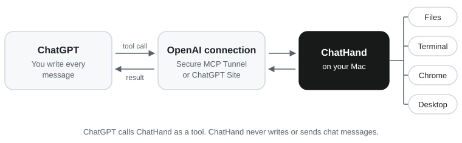

# ChatHand

[中文](README.zh-CN.md)

**Put your ChatGPT chat quota to work on your Mac—for free.**

Codex weekly limit hit? Switch to a regular ChatGPT chat and keep working.

ChatHand is a free Mac app that connects ChatGPT to your computer. Ask it to organize files, use Chrome, run commands, or work with apps on your desktop.

[Download for Mac](https://kenyupersonal-maker.github.io/chathand-site/) · [Installation guide](docs/INSTALL.en.md) · [Report an issue](https://github.com/kenyupersonal-maker/chathand/issues)

You start every chat. ChatHand only runs the tools ChatGPT calls, within the access you allow, and never sends messages on its own. [Will it get my account banned?](#will-chathand-get-my-chatgpt-account-banned)

## Get started

1. Download and open the ChatHand disk image.
2. Choose **Install with ChatGPT** to have Codex in the ChatGPT desktop app help with installation and setup, or follow the manual installation and setup steps. If your Codex allowance is exhausted, use the manual route.
3. In ChatGPT, open Settings → Plugins → ChatHand and set its permission to **Allow all tools**. Otherwise file writes and commands get blocked, or ask you every time.
4. Open a regular ChatGPT chat, mention **@ChatHand**, and ask it to do something on your Mac.

> [!NOTE]
> ChatHand is a beta and is not notarized by Apple. Follow the first-open instructions in the disk image if macOS blocks it.

## Requirements

- **Mac:** An Apple silicon Mac running macOS 14 or later.
- **ChatGPT:** An account with access to custom apps and the required tool permissions. Workspace administrators may control availability.
- **Optional apps:** ChatGPT for macOS if you want help with installation and setup. Google Chrome is needed for browser control.
- **Connection:** For the OpenAI Tunnel route, access to the OpenAI platform to create the tunnel and runtime key. ChatGPT Site is also available as a connection route.
- **Nothing else to install:** No Node.js or Homebrew needed. Everything ships inside the app.

## Your Mac, your choice

- **Full or Light.** Full lets ChatGPT work across your whole Mac. Light keeps it to one folder you pick.
- **Risky actions are off by default.** Admin access, bulk deletes and other high-risk actions each have their own switch.
- **macOS and Chrome keep their own gates.** Desktop control needs macOS Accessibility and Screen Recording, which you grant in System Settings. Sign-ins and system prompts stay with macOS, Chrome and OpenAI; the AI doesn't click them for you.
- **Stop it anytime.** Press ⌃⌥⎋, choose **Pause AI** in the ChatHand menu bar icon, or click **Stop** on a running task.
- **Your key stays local.** The runtime key is encrypted on your Mac, and ChatHand shows only its last four digits. Don't paste it into a chat or issue.

## Will ChatHand get my ChatGPT account banned?

ChatHand is built on the way OpenAI documents for connecting tools to ChatGPT, and it doesn't do what usually gets accounts flagged: scripts that send chats or scrape answers, getting around usage limits, or reselling and sharing access. ChatGPT stays in charge of the chat and calls ChatHand as a tool. We can't speak for OpenAI, so here is exactly what ChatHand does:

- **Official route.** ChatHand is a custom MCP app in ChatGPT, connected through OpenAI's [Secure MCP Tunnel](https://developers.openai.com/api/docs/guides/secure-mcp-tunnels) or a ChatGPT Site. See OpenAI's guide to [developer mode and MCP apps](https://help.openai.com/en/articles/12584461).
- **You send every message.** ChatHand never types or sends messages in ChatGPT and doesn't run chats in the background. When it opens ChatGPT with a message filled in, for setup or the connection test, you press Enter.
- **No sign-in, no proxy.** ChatHand never asks for your ChatGPT password or signs in for you. The connection carries tool calls between your ChatGPT and your own Mac. It isn't an API proxy and doesn't share your account.
- **Your usual limits.** Everything happens in your own chats, under your plan's usual limits.
- **One click in ChatGPT, on its own page.** With the Chrome extension connected, after an update ChatHand can open its own page in ChatGPT settings and click Refresh, so ChatGPT picks up the new tools. It never clicks delete, disconnect or permission buttons. It also reads which ChatGPT tab is answering, to link a task to its chat. Anything more takes the high-risk switch **Control ChatGPT’s own web and desktop app**, off by default. Its warning says it plainly: automated messaging breaks OpenAI's terms, so leave it off unless you need it.

Use your own account, follow OpenAI's [Terms of Use](https://openai.com/policies/terms-of-use/) and [Usage Policies](https://openai.com/policies/usage-policies/), and don't use ChatHand, or anything else, to script ChatGPT chats. ChatHand is an independent project and isn't affiliated with OpenAI.

## Feedback

In ChatHand, open **Help & Feedback**, click **Export Diagnostics**, and attach the file to an [issue](https://github.com/kenyupersonal-maker/chathand/issues/new/choose). The file leaves out keys, accounts, file paths and chat content, and you can open it before you send it.

## License

ChatHand is source available under [MIT with Commons Clause 1.0](LICENSE). You may use, modify, and redistribute it, subject to the restriction on selling the software or a product or service whose value derives entirely or substantially from its functionality, as defined by "Sell" in the license. The copyright holder and Licensor are Ken Yu.

The MIT license inside the Site template ZIPs and the separate third-party licenses remain unchanged. See [THIRD_PARTY_NOTICES.md](THIRD_PARTY_NOTICES.md) and [licenses/](licenses/).
