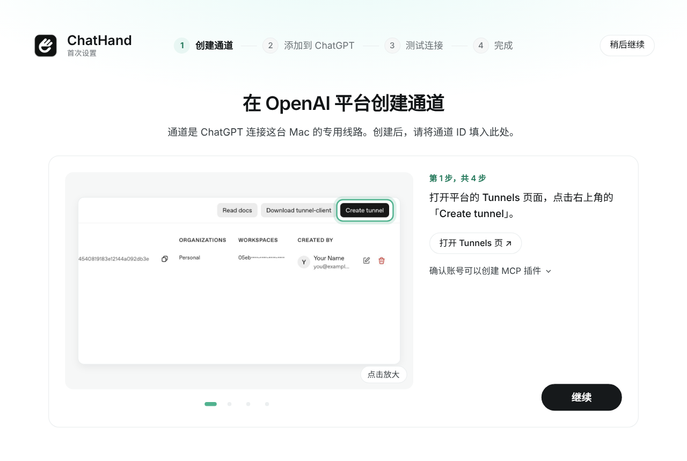
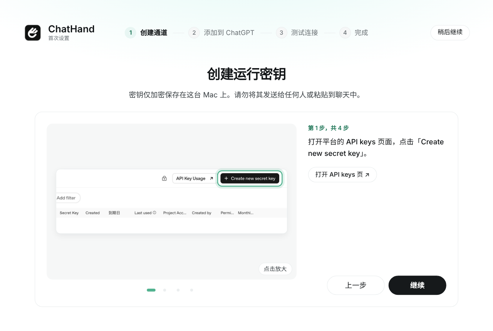
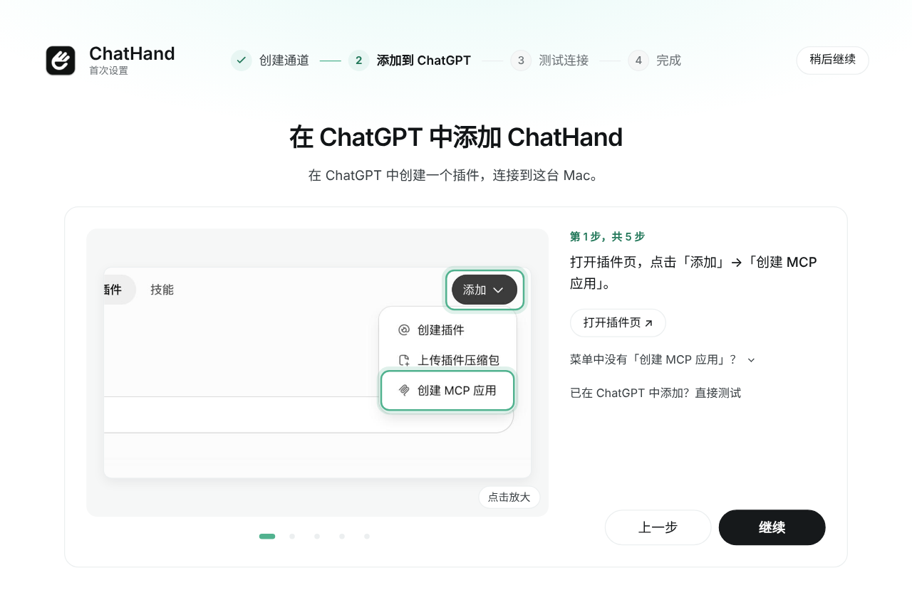
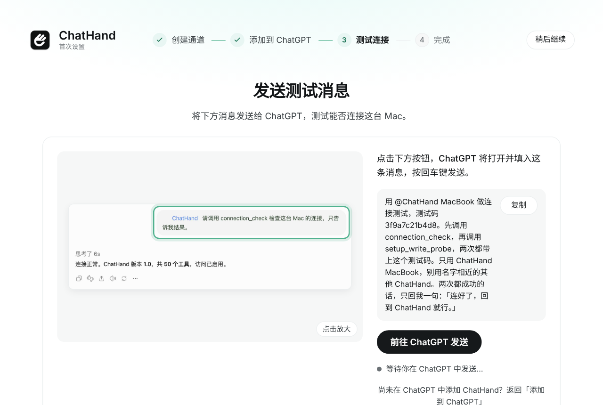
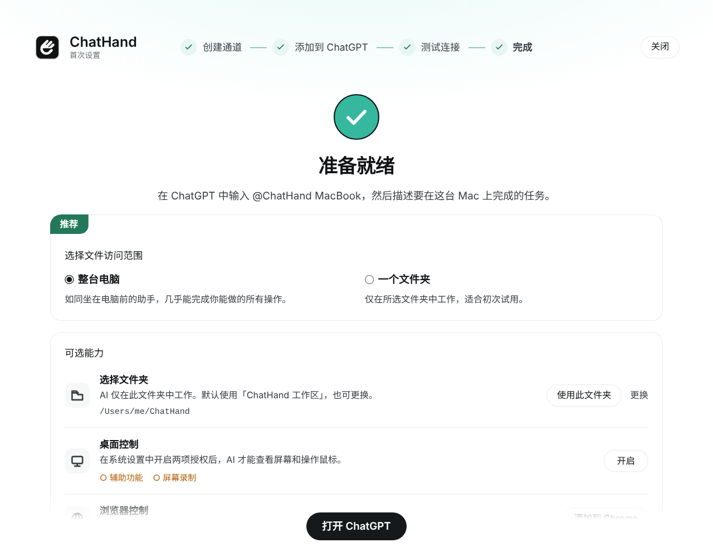

# ChatHand

[English](README.md)

**把 ChatGPT 的聊天额度用起来，让 AI 在你的 Mac 上干活。**

Codex 周额度用完了？切到 ChatGPT 普通聊天，接着干。

ChatHand 装在你的 Mac 上，通过 OpenAI 的安全通道把本机能力接给 ChatGPT：读写你指定文件夹里的文件、跑命令、操作浏览器和桌面。连接后可在支持该自定义应用的 ChatGPT 客户端中使用，具体取决于账号、设备和工作区权限。

> 当前为测试版。ChatHand 尚未通过 Apple 公证；首次打开时按安装盘的说明操作即可。

## 用之前要准备的

- 一台 Apple 芯片（M 系列）的 Mac，macOS 14 或更新。
- 一个有权使用自定义 MCP 应用及所需工具权限的 ChatGPT 账号。Pro 账号曾通过读写实测；其他套餐及设备的可用性请以账号实际权限为准。团队或企业工作区可能需要管理员开启开发者模式和应用权限。
- ChatGPT 桌面版：想让 ChatGPT 帮你装、帮你配，就要装它；自己装、自己配也可以不装。
- 用你登录 ChatGPT 的账号登录 OpenAI 平台（platform.openai.com），在那里建通道和运行密钥。
- 要让 AI 操作浏览器时，需要 Google Chrome。
- 这台 Mac 要能连上 OpenAI。需要代理的地区，代理要一直开着。
- 不用装 Node 或 Homebrew，安装包里都带了。

## 安装

获取当前版本的 ChatHand macOS 安装盘，双击打开。然后二选一：

- **交给 ChatGPT（推荐）**：双击安装盘里的「让 ChatGPT 来装」，浏览器问要不要打开 ChatGPT 时点「打开」。ChatGPT 填好下面这句话后按回车，它会自动转到「工作」，把安装、macOS 的首次放行、连上 ChatGPT 一路做完，ChatHand 里会显示进度。遇到系统或 ChatGPT 规定要你确认的地方（登录、授权），它会先说一句这一步在做什么。

  ```text
  进入 Work 模式，帮我安装 ChatHand 并连上 ChatGPT。安装包在「下载」文件夹里，步骤写在安装包里的 ChatHand.app/Contents/Resources/codex/INSTALL.md。
  ```

- **自己装**：双击安装盘里的「第一次打开」，点「复制命令」，到「终端」粘贴、回车。这行命令会把 ChatHand 装进「应用程序」、去掉下载标记，再把它打开。终端用不了的话，同一页下面有在系统设置里放行的配图步骤；也可以先把 ChatHand 拖进「应用程序」。打开后跟着设置走，详细步骤见 [安装说明](docs/INSTALL.md)。

安装盘已经推出、找不到「第一次打开」？去「下载」里重新双击 DMG。

## 手动设置

不交给 ChatGPT、自己配的话，打开 ChatHand，在首次设置里点「我自己配」下面的「开始」，会带你走下面四步。默认用 OpenAI 通道；想改用 ChatGPT Site，先点「切换连接方式」，再照页面上的提示做。每一页都配了截图，标出了要点的位置。

**1. 创建通道。** 点「打开 Tunnels 页」，在 OpenAI 平台点右上角的「Create tunnel」：Name 随便填，Description 写一句说明，「ChatGPT workspaces」一定要选上你的工作区，再点「Create」。把列表里的通道 ID 复制下来，粘贴回 ChatHand。



接着建运行密钥：点「打开 API keys 页」，点「Create new secret key」。Project 选 Default project，有效期选「永不」；Permissions 选「Restricted」，只给「Tunnels」勾 Read 和 Use。点「Create secret key」，再点「Copy」，ChatHand 会自己收到，不用粘贴。密钥不要发给任何人，也不要贴进聊天。



**2. 添加到 ChatGPT。** 点「打开插件页」，点「添加」→「创建 MCP 应用」。名称照 ChatHand 页面上给的填；「连接」切到「隧道」，选刚建的通道；「身份验证」选「无需身份验证」，勾上「我已了解，并希望继续」，点「创建」，再点「连接」。最后在 ChatGPT 的 设置 → 插件 → ChatHand 里，把「权限」选成「允许使用所有工具」。



**3. 测试连接。** 点「前往 ChatGPT 发送」，ChatGPT 会打开并填好测试消息，按回车发送。ChatHand 收到后会自己进到下一步。



**4. 完成。** 选 ChatGPT 能动多大范围（整台电脑，或者一个文件夹），点「打开 ChatGPT」。在 ChatGPT 里输入 @ChatHand，说你要它在这台 Mac 上做什么。浏览器控制和桌面控制用到时再开。



## 第一次使用

在 ChatGPT 里打开 设置 → 插件 → ChatHand，在「权限」里选「允许使用所有工具」。不改的话，写文件、跑命令会被拦下，或者每次都要你点允许。ChatHand 能做什么，仍由它自己的权限档位和高危开关决定。

## 安全

- 运行密钥经加密保存在这台 Mac 的本地文件中，界面只显示末四位。不要把密钥贴进聊天或 Issue。
- ChatGPT 能动多大范围，看你选的档：「完整」是整台电脑，「轻量」只在你选的一个文件夹里。管理员权限和几项高危操作单独开关，默认都关着。
- 桌面控制要用 macOS 的「辅助功能」和「屏幕录制」，开不开由你在系统设置里定。
- 随时可以让 AI 停下：按 ⌃⌥⎋，或者在菜单栏的 ChatHand 里点「暂停 AI」；有任务在跑时，ChatHand 里也有「停止」。
- 系统弹窗、Chrome 的授权和各种登录，由 macOS、Chrome 和 OpenAI 自己把关，AI 不代点。

## 反馈

在 ChatHand 右栏的「帮助与反馈」里点「导出诊断包」，把文件附在 [Issue](https://github.com/kenyupersonal-maker/chathand/issues/new/choose) 里；同一页的「前往 GitHub 反馈」会直接打开 Issue 页面。诊断文件不含密钥、账号、文件路径和聊天内容，提交前你也可以打开看一眼。

## 许可证

ChatHand 的源码公开，采用 [MIT 加 Commons Clause 1.0](LICENSE)。允许使用、修改和再分发；不得按条款中「Sell」的定义销售本软件或价值主要来自其功能的产品或服务。版权人和 Licensor 为 Ken Yu。

Site 模板 ZIP 内的 MIT 许可和第三方组件各自的许可证保持原样，见 [THIRD_PARTY_NOTICES.md](THIRD_PARTY_NOTICES.md) 和 [licenses/](licenses/)。
